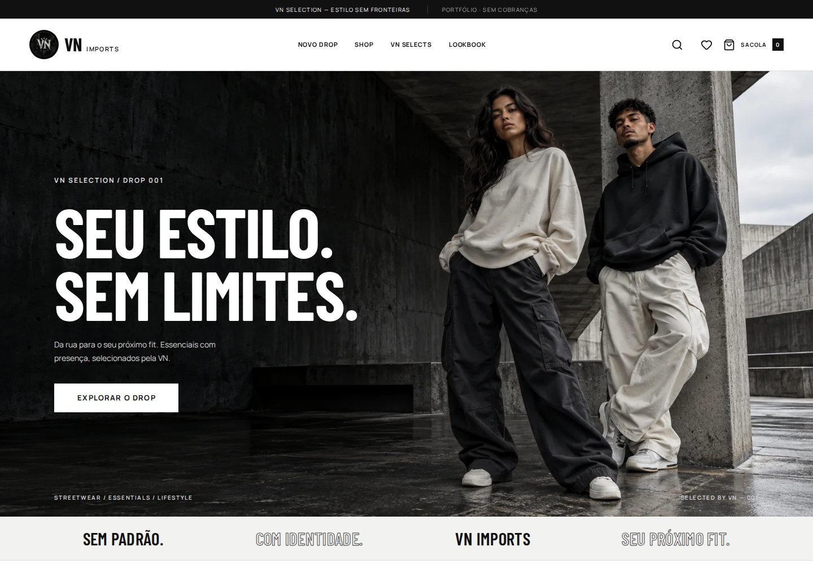
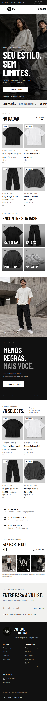
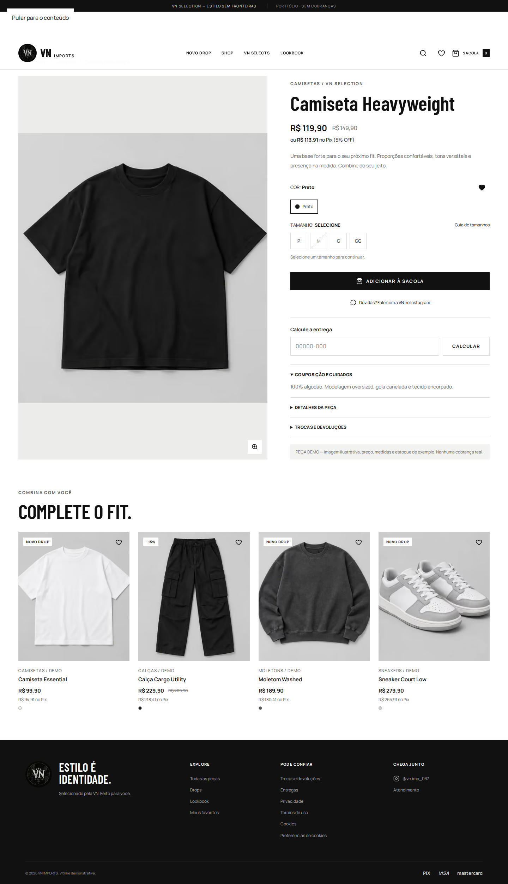

**English** · [Português (Brasil)](README.pt-BR.md)

# VN Imports — Portfolio

A streetwear e-commerce project with monochrome art direction, a responsive storefront, and an admin dashboard. This edition is **for demonstration only**, designed for exploring the experience and reviewing the code locally.

**Next.js 16 · React 19 · TypeScript · Tailwind CSS · Vitest · Playwright**



## About the project

An editorial storefront with a complete simulated shopping flow: product discovery, variant selection, a persistent shopping bag, coupons, demo shipping, and order tracking. The admin dashboard supports catalog management and inventory history.

| Experience | Implementation |
| --- | --- |
| Storefront | Responsive layout, drops, categories, lookbook, search, and filters |
| Product | Variants, stock availability by size, size guide, and image zoom |
| Simulated checkout | Shopping bag, favorites, coupons, shipping, and guest orders with private access |
| Local administration | Login, products, photos, inventory, orders, and settings |
| Commerce rules | Amounts stored in cents, stock reservations, idempotency, and history |
| Quality | Zod validation and domain, database, security, and browser tests |

<details>
<summary>View the mobile storefront</summary>



</details>

<details>
<summary>View the product page</summary>



</details>

The screenshots show the demo edition and its sample catalog. Fashion photographs were generated for demonstration; prices and stock are fictional. The VN logo belongs to the brand identity supplied for the project.

## Run locally

Requirements: **Node.js 24 LTS** and npm.

```bash
git clone https://github.com/DevKaz-source/vn-imports-portfolio.git
cd vn-imports-portfolio
npm ci
npm run setup
npm run dev
```

On Windows PowerShell, use `npm.cmd` instead of `npm` if the script execution policy blocks the command. There is no need to disable that protection.

Open [localhost:3000](http://localhost:3000). The admin dashboard is at [localhost:3000/admin](http://localhost:3000/admin). `setup` generates credentials unique to your installation and saves them in `.data/acesso-local.txt`. There is no shared default admin password.

The server listens on `127.0.0.1` by default. Demo data stays in the `.data` folder on your machine; no external database is required. To reset the catalog, stop the server and remove only `.data/store.json`. Keep `.env.local` and `.data/acesso-local.txt` to preserve your login.

The demo interface is in Brazilian Portuguese. The walkthrough below keeps the on-screen product and button names so you can find them easily.

## Demo walkthrough

1. Open **Camiseta Heavyweight**, select size **P** (small), and add it to your bag. Size **M** (medium) starts out of stock.
2. Proceed to checkout and use fictional information only. Enter the address manually; this edition makes no external postal-code lookup.
3. Calculate demo shipping and try coupon `VNDEMO10`, limited to one use per email address.
4. Create the order and click **Simular pagamento aprovado** (simulate an approved payment). No charge is made.
5. In the admin dashboard, inspect the order, upload a test image, and adjust stock with a reason.

## Scope and limitations

- The code keeps demo mode enabled even if someone sets `STORE_MODE=live`; incompatible configuration is rejected.
- Provider adapters and the SQL schema remain as architectural references. This edition does not enable real payments, commercial shipping, hosted Supabase, or payment-provider webhooks.
- Do not deploy this demo server with personal data or as a live store. Persistence uses local files and is intended for evaluation in a single process.
- GitHub hosts the source code and this presentation. The application requires Node.js and is not a static export for GitHub Pages.
- This repository contains no private credentials, real orders, private environment files, or customer uploads.

## Verification

```bash
npm run check:public
npm run audit:dependencies
npm run check
npx playwright install chromium
npm run test:e2e
```

`check:public` inspects Git-tracked files for private files and common credential patterns. The CI workflow is configured to run that check, the dependency audit, linting, type checks, tests, a production build, and browser flows. Dependabot tracks npm dependencies and GitHub Actions.

An ESLint 9 deprecation warning may appear: that version is retained for compatibility with the current plugins. Do not run `npm audit fix --force`. Recorded results are available in [VALIDACAO.md](docs/VALIDACAO.md) (Brazilian Portuguese).

## Project structure

| Directory | Responsibility |
| --- | --- |
| `src/app` | Pages and API endpoints |
| `src/components` | Storefront, checkout, and admin UI |
| `src/domain` | Types, validation, and commerce rules |
| `src/server` | Sessions, inventory, persistence, and uploads |
| `src/integrations` | Reference provider adapters and simulations |
| `supabase` | Reference SQL schema |
| `tests` | Unit, integration, and browser tests |

Read [SECURITY.md](SECURITY.md) (Brazilian Portuguese) for the demo's protections and limitations. The brand, logo, and visual materials are presented as part of this project; publication does not transfer rights to the VN Imports brand identity.
